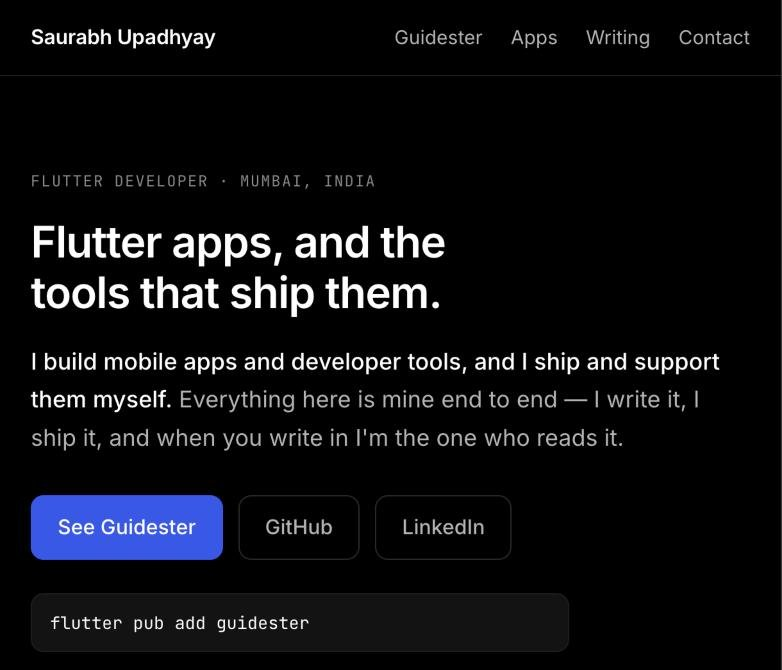

# saurabhupadhyay.in

Personal site of Saurabh Upadhyay. Plain HTML and CSS: no framework, no build step,
no JavaScript. Only the `public/` folder is published; `README.md`, `.gitignore`
and `wrangler.jsonc` stay at the repo root and are never served.



Live at **[saurabhupadhyay.in](https://saurabhupadhyay.in)**. Every pull request runs HTML validation, layout checks at three widths, axe (WCAG 2.2 AA), Lighthouse budgets and a link check (see [Checks](#checks)).

## Files

Everything below lives in `public/`.

| File | Page |
|---|---|
| `index.html` | Home |
| `guidester.html` | Guidester product page |
| `products.html` | Apps: Sanatan Guide, Sahaj, Snapdrop |
| `terms.html`, `privacy.html`, `refund.html`, `contact.html` | Legal pages for payment-gateway onboarding |
| `llms.txt` | Plain-text summary for AI assistants and search: who I am, what's live, where to check it ([llmstxt.org](https://llmstxt.org)) |
| `404.html` | Not-found page (served via `not_found_handling` in `wrangler.jsonc`) |
| `style.css` | Shared styles (Guidester dashboard tokens, Inter + JetBrains Mono) |
| `guidester-demo.{webm,mp4}`, `guidester-demo-poster.webp` | The demo as video (one `<video>`, WebM first) and its still, for `prefers-reduced-motion`. Built from `media/guidester-demo.gif`, copied from the Guidester repo so the site loads nothing from GitHub |
| `guidester-demo-phone.{webm,mp4}`, `guidester-demo-phone-poster.webp` | The phone-only crop, served on screens up to 600px wide (`<source media>`), so each viewport downloads one video |
| `.assetsignore` | Keeps `.git` and `.wrangler` out of the published assets |

Links and the stylesheet use root-absolute paths (`/style.css`), so preview with a
local server rather than opening files directly:

```bash
python3 -m http.server 8000 -d public
# open http://localhost:8000
```

Internal links are extensionless (`/guidester`), matching how Cloudflare serves
the site. A plain local server doesn't map those to `.html`, so in local preview open
pages by filename (`/guidester.html`).

## Before going live

1. **Read the legal pages.** `terms.html`, `privacy.html`, `refund.html` and
   `contact.html` are templates (each has a notice comment at the top). Review them
   before relying on them or submitting them to a payment gateway.
2. **Email.** Done: every page uses `hello@saurabhupadhyay.in` (Cloudflare Email
   Routing). Check `grep -rn gmail public/` stays empty.

## Deploy (Cloudflare Workers, static assets)

The site is a Cloudflare Worker with no script, serving static assets. Config is
`wrangler.jsonc`: it publishes `./public` only and serves `404.html` for unknown
paths. Keep `"name": "saurabhupadhyay-in"`; changing it creates a second Worker.

Cloudflare is connected to `Saurabh-7973/saurabhupadhyay.in` on GitHub. Every push
to `main` redeploys. There is no build step and no `package.json`.

Every other branch gets a preview build (`npx wrangler preview`), with its URL in
the "Workers Builds" check on the pull request. That command fails unless
`wrangler.jsonc` has a `previews` block, so keep the empty `"previews": {}`.

## Custom domain

Once the domain's nameservers point at Cloudflare:

1. Worker → **Settings → Domains & Routes → Set up a domain** → `saurabhupadhyay.in`.
   Cloudflare creates the DNS record.
2. Add `www.saurabhupadhyay.in` as well and redirect it to the apex.

HTTPS is automatic.

## Rebuilding the demo video

`media/` holds the GIF masters; nothing there is served. After replacing
`media/guidester-demo.gif`:

```bash
gifsicle --crop 20,20+252x560 -O3 media/guidester-demo.gif -o media/guidester-demo-phone.gif
for g in guidester-demo guidester-demo-phone; do
  ffmpeg -y -i media/$g.gif -movflags +faststart -pix_fmt yuv420p \
    -vf "fps=25,scale=trunc(iw/2)*2:trunc(ih/2)*2" -c:v libx264 -preset veryslow -crf 26 -an public/$g.mp4
  ffmpeg -y -i media/$g.gif -vf fps=25 -pix_fmt yuv420p -c:v libvpx-vp9 -b:v 0 -crf 40 -row-mt 1 -an public/$g.webm
  ffmpeg -y -sseof -1.2 -i public/$g.mp4 -frames:v 1 /tmp/$g-poster.png
  cwebp -q 80 /tmp/$g-poster.png -o public/$g-poster.webp
done
```

`fps=25` matters: the GIFs use variable frame durations, and without it the
video comes out shorter than the GIF.

## Checks

`.github/workflows/site-checks.yml` runs on every PR and on `main`, against
`public/` served locally. The tooling lives in `tests/` (its own
`package.json`), so none of it is published.

| Check | What fails it |
|---|---|
| HTML validation (`html-validate`) | Invalid markup in any page |
| Layout (Playwright) | Any page scrolling sideways at 360, 390 or 1280px |
| Accessibility (axe, WCAG 2.2 AA) | Any violation at 390 or 1280px |
| Demo video | Either viewport downloading more or less than one video |
| Demo poster | A 390px phone loading the desktop poster or a desktop loading the phone one; the desktop video box blank before its first frame |
| Lighthouse CI | Performance under 95, accessibility, best practices or SEO under 100, a page over 250 KB, any third-party request |
| Links (lychee) | A broken internal or external link (Medium and LinkedIn excluded: they block bots) |

Run them locally:

```bash
cd tests
npm ci
npx playwright install chromium
npm run html && npm run e2e && npm run lighthouse
```

## Licence

The code is MIT licensed (see [LICENSE](LICENSE)). The writing, product names, logos and images on the site are © Saurabh Upadhyay and are not covered by that licence.
